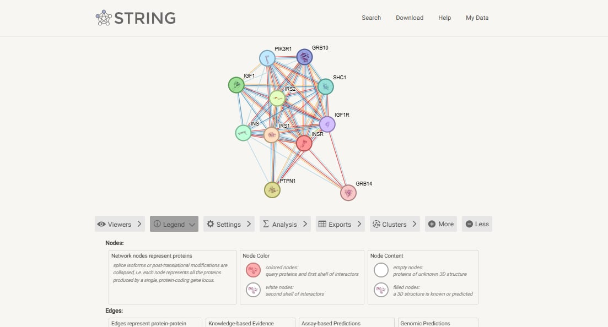

## Individual Cell-to-Cell Communication Laboratory

## Title and Biological Question

**Title:** Insulin Signaling Between Pancreatic Beta Cells and Skeletal Muscle Cells

**Biological Question:** How does insulin produced by pancreatic beta cells communicate with skeletal muscle cells through the insulin receptor, and which proteins are involved in the signaling pathway?

## Chosen Sender Cell and Biological Context

The chosen sender cell is the pancreatic beta cell. These cells produce insulin, a hormone involved in regulating blood glucose levels. Insulin is released into the bloodstream and communicates with target cells through endocrine signaling.

## Candidate Ligand and Evidence for Sender-Cell Expression

**Candidate ligand:** Insulin  
**Gene:** INS

According to the Human Protein Atlas results, INS expression is enriched in pancreatic beta cells, and insulin is secreted into the blood. These findings support insulin as the candidate signaling molecule produced by the sender cell.

## Receptor and Receiver Cell with Supporting Evidence

**Receiver cell:** Skeletal muscle cell  
**Receptor:** Insulin receptor  
**Gene:** INSR  
**UniProt accession:** P06213

OmniPath supports the INS–INSR signaling relationship. UniProt provides information about the insulin receptor and its expression in tissues targeted by insulin's metabolic effects, including skeletal muscle. These findings support skeletal muscle cells as the selected receiver cells.

## OmniPath Findings

OmniPath showed a directed signaling relationship between insulin (INS) and the insulin receptor (INSR). The results included multiple supporting sources and 55 references.

This finding supports the proposed ligand–receptor relationship between the pancreatic beta cell's signaling molecule and the receptor on the receiver cell.

## STRING Network Interpretation

STRING was used to examine the protein interaction network associated with INSR. The selected network included the following proteins:

- INSR
- IRS1
- PTPN1
- IRS2
- IGF1
- INS
- SHC1
- PIK3R1
- GRB10
- IGF1R
- GRB14

The KEGG pathway enrichment results included the insulin signaling pathway, insulin resistance, Type II diabetes mellitus, and AMPK signaling.

The network identifies proteins associated with insulin receptor signaling. STRING functional associations do not necessarily mean that every connected protein physically binds to another protein.

 

## IntAct Validation

The selected IntAct result involved the insulin receptor (INSR) and protein tyrosine phosphatase non-receptor type 1 (PTPN1).

- **Molecule A:** INSR
- **UniProt accession:** P06213
- **Molecule B:** PTPN1
- **UniProt accession:** P18031
- **Organism:** Homo sapiens
- **Detection method:** X-ray diffraction
- **Interaction type:** Direct interaction
- **Publication ID:** 11163213
- **Interaction accession:** EBI-7483949
- **MI Score:** 0.98

This result provides evidence for the selected INSR–PTPN1 molecular interaction in the IntAct database.

## Final Model and Interpretation

### Proposed Signaling Model

Pancreatic beta cell → Insulin (INS) → Bloodstream → Insulin receptor (INSR) on skeletal muscle cell → IRS1 → PI3K → AKT → Increased glucose uptake

### Interpretation

The pancreatic beta cell acts as the sender cell by producing and releasing insulin (INS), a hormone that travels through the bloodstream to reach target cells. In this model, the skeletal muscle cell serves as the receiver cell because it expresses the insulin receptor (INSR). When insulin binds to INSR on the cell membrane, the receptor becomes activated and starts an intracellular signaling cascade.

The activated receptor signals through insulin receptor substrate 1 (IRS1), which helps transmit the signal to phosphoinositide 3-kinase (PI3K). This activates downstream signaling involving AKT. These signaling events promote the movement of glucose transporters to the cell membrane, allowing the skeletal muscle cell to take up more glucose from the blood. The glucose can then be used to produce energy or stored for later use.

The STRING network identified proteins associated with insulin receptor signaling, while its KEGG pathway enrichment results included the insulin signaling pathway. IntAct also provided evidence for an interaction between INSR and PTPN1, a protein involved in regulating insulin receptor signaling. Together, these findings support the proposed role of insulin in communication between pancreatic beta cells and skeletal muscle cells.

## References and Database Links

- Human Protein Atlas. https://www.proteinatlas.org/ 
- OmniPath Explorer. https://explore.omnipathdb.org/
- UniProt — Insulin Receptor (P06213). https://www.uniprot.org/uniprotkb/P06213/entry
- STRING. https://string-db.org/ 
- IntAct. https://www.ebi.ac.uk/intact/ 
